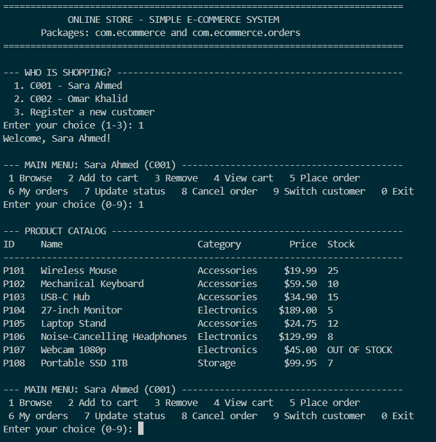
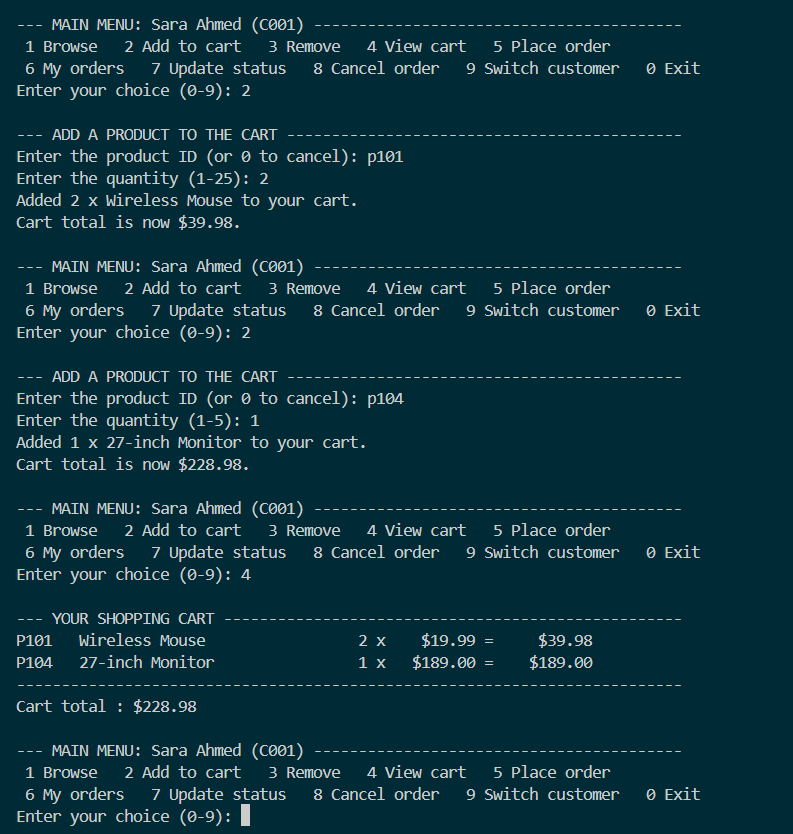
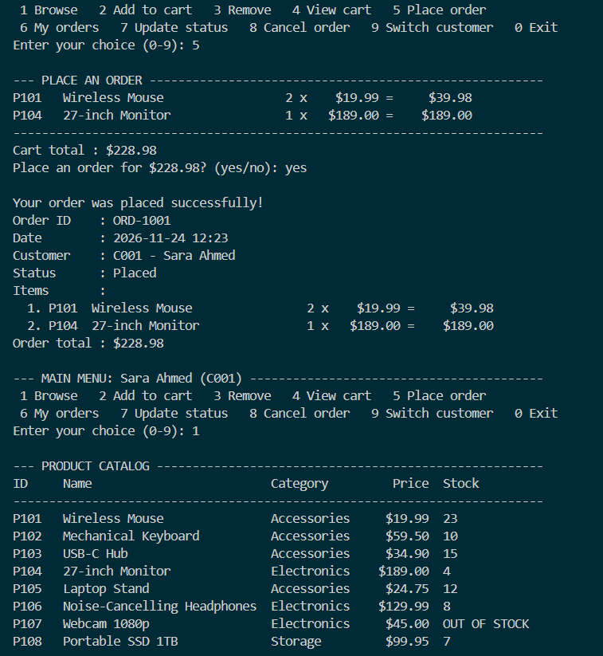
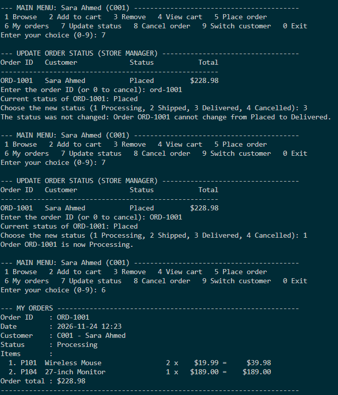
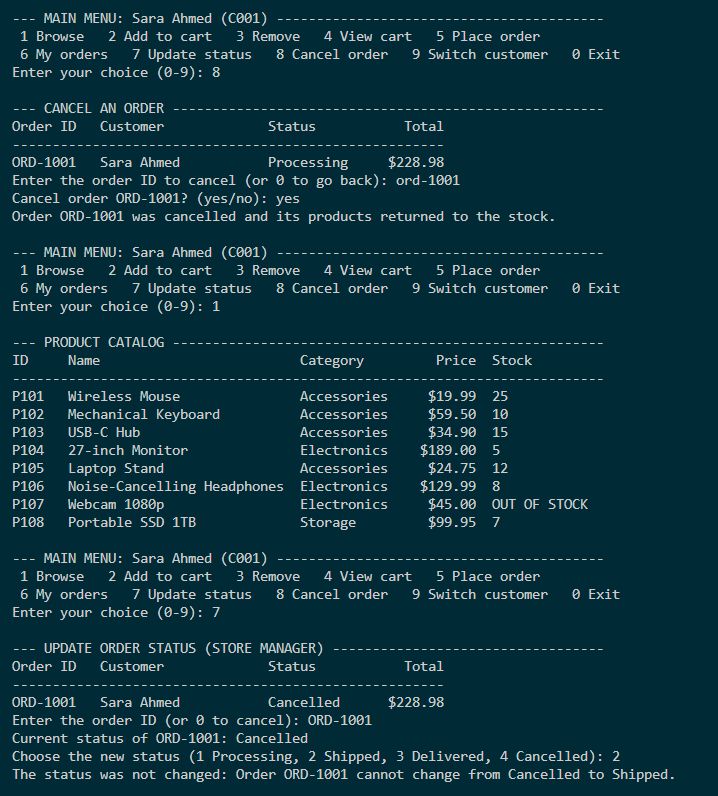
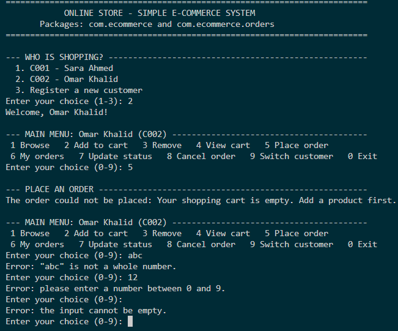
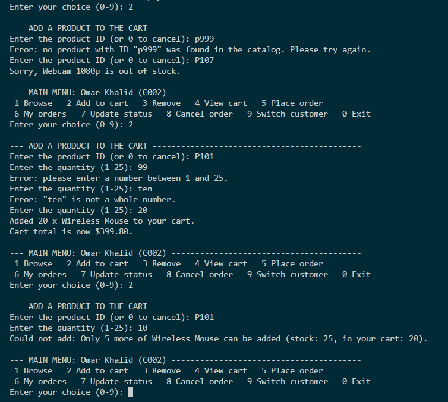
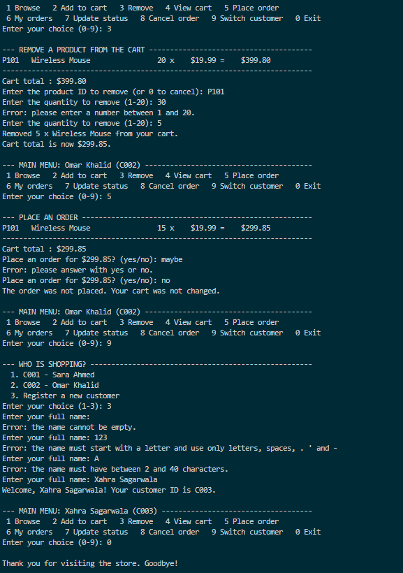

# Java E-Commerce System

A console-based online store written in Java 8. It shows how to organize a
program into **packages**, protect data with **access modifiers**, and handle
bad input with **validation and exceptions**.

Customers can browse products, fill a shopping cart, place orders and cancel
them. A store manager can move an order through its stages.

## Features

- Product catalog with price, category and stock
- Shopping cart with stock checks (including units already in the cart)
- Orders with an order summary, date, total and status
- Order status rules: Placed, Processing, Shipped, Delivered or Cancelled
- Cancelling an order returns its products to the stock
- Input validation for menu choices, IDs, quantities, names and yes/no answers
- No external libraries

## Project structure

```
java-ecommerce-system/
  EcommerceApp.java            main program (default package)
  com/
    ecommerce/
      Product.java
      Customer.java
      orders/
        Order.java
        OrderItem.java
        OrderStatus.java
        OrderException.java
```

| Package | Classes |
| --- | --- |
| (default) | `EcommerceApp` |
| `com.ecommerce` | `Product`, `Customer` |
| `com.ecommerce.orders` | `Order`, `OrderItem`, `OrderStatus`, `OrderException` |

## Design notes

- All fields are `private`. `Product.reduceStock` is package-private, so only
  `Customer` can lower the stock, and only through a valid order.
- Invalid arguments throw `IllegalArgumentException`. Business problems, such
  as an empty cart or an invalid status change, throw the checked
  `OrderException`.
- `placeOrder` is all-or-nothing: every cart line is checked before anything
  changes.
- `OrderStatus.canChangeTo` keeps the status rules in one place.
- Known limitations: `Customer` and `Order` depend on each other across
  packages, money uses `double` (`BigDecimal` is better for production), and
  data lives in memory only.

## Run it

You need a JDK 8 or newer. From the project folder:

```
javac EcommerceApp.java
java EcommerceApp
```

In VS Code, open this folder and press Run above `main` in `EcommerceApp.java`.

## Screenshots

Browsing the catalog:



Adding products to the cart:



Placing an order:



Updating the order status:



Cancelling an order and restoring the stock:



Input validation:





## Author

Elyas Ghwiet, Computer Science student at University of the People.
